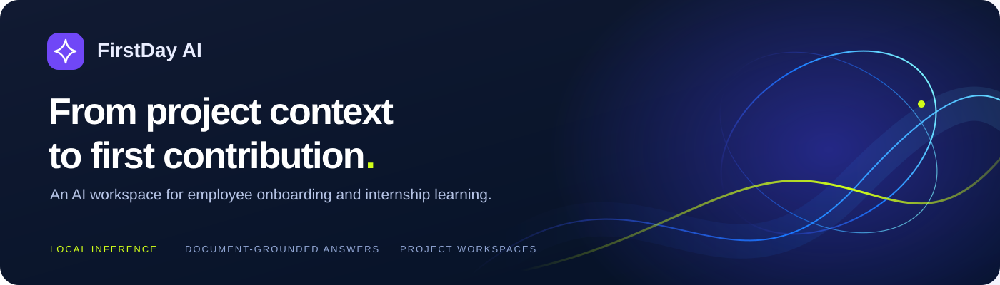
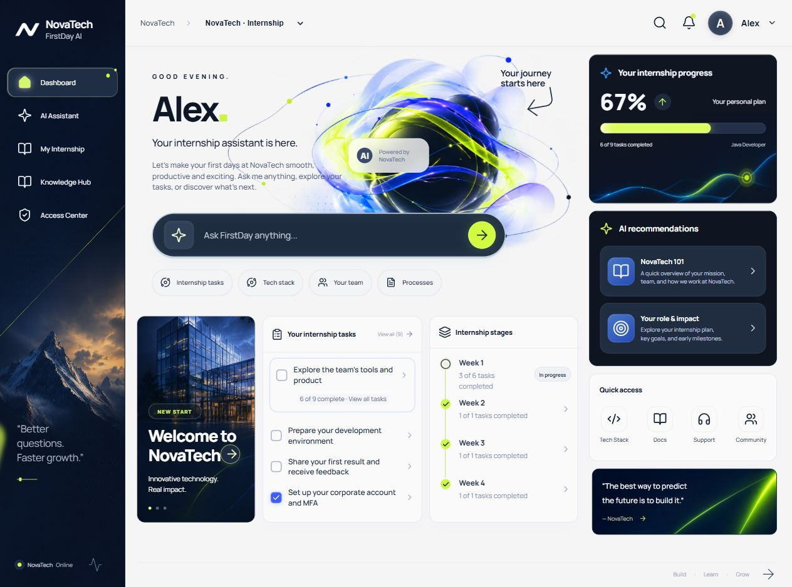
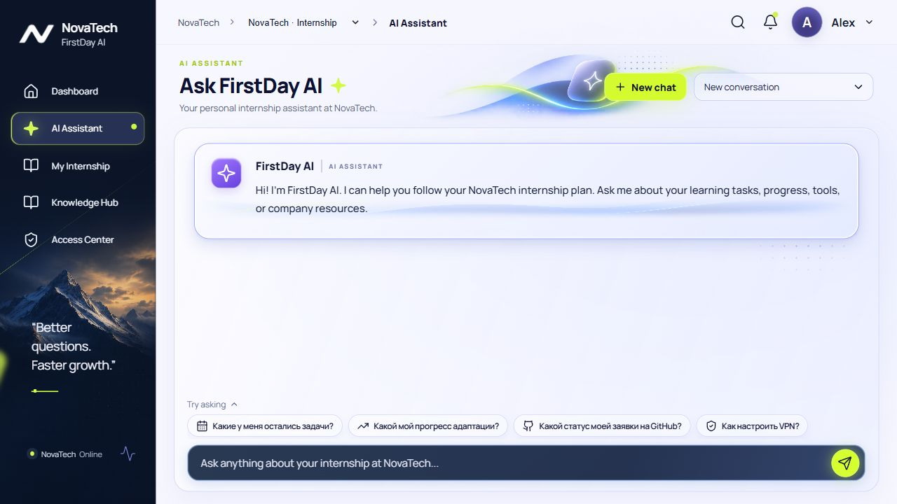
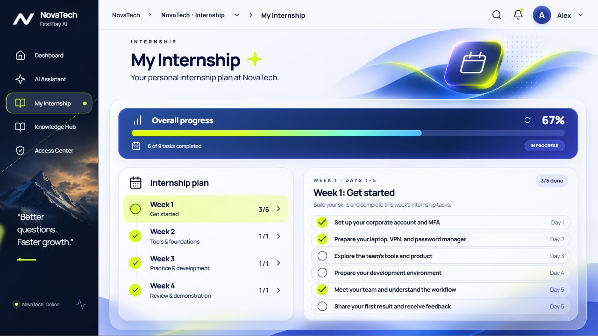
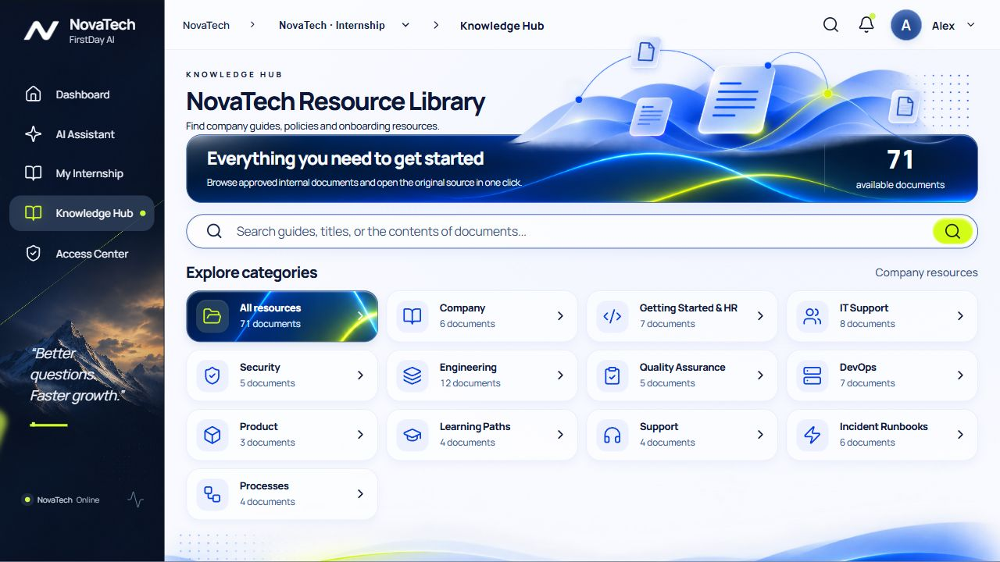
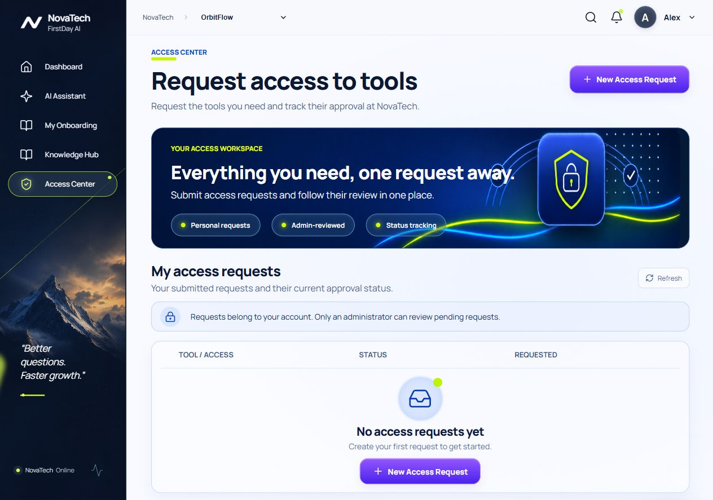
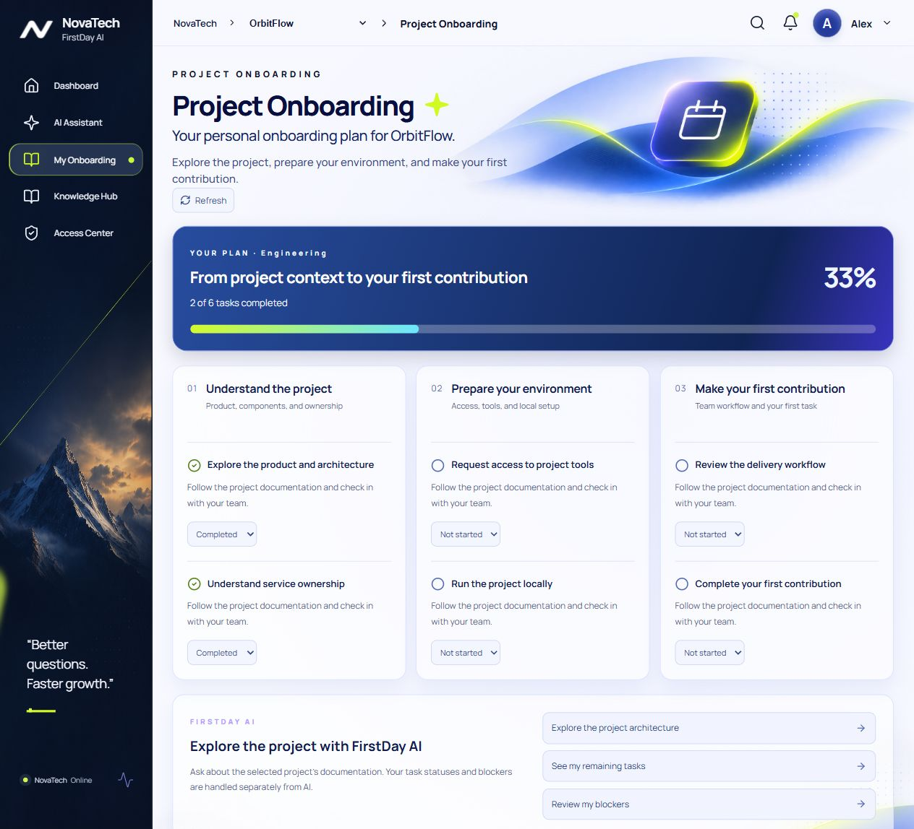
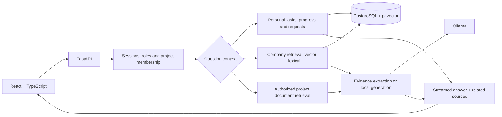

<p align="center">
  
</p>

<p align="center"><strong>Employee onboarding, project knowledge, and a clear next step — in one workspace.</strong></p>

<p align="center">
  <a href="https://github.com/anasteyshaK/firstday-ai/actions/workflows/ci.yml"></a>
</p>

<p align="center">
  <a href="#product-tour">Product tour</a> ·
  <a href="#features">Features</a> ·
  <a href="#architecture">Architecture</a> ·
  <a href="#running-locally">Run locally</a> ·
  <a href="#quality-and-evaluation">Evaluation</a>
</p>

FirstDay AI helps employees find their way into an IT project: understand the product, prepare their environment, find relevant documentation, and make their first contribution. It also includes a dedicated internship learning journey with a personal plan and progress tracking.

Built around the fictional company **NovaTech**, the project combines a React interface, a FastAPI backend, persistent PostgreSQL data, and local AI inference through Ollama.



## Features

| Capability | In the application |
| --- | --- |
| **AI Assistant** | Ask documentation questions, receive streamed responses, inspect related sources, and return to saved conversations. |
| **Project Onboarding** | Follow a role-specific route through project context, environment setup, and your first contribution. Track task statuses and blockers. |
| **Internship** | Work through a personal learning plan with weekly tasks and saved progress. |
| **Knowledge Hub** | Browse categories, search company resources, and open the underlying documentation. |
| **Access Center** | Submit tool access requests and follow their review status. |
| **Administration** | Manage employee profiles, review access requests, and assign or revoke project membership. |
| **Personal context** | Ask about your own tasks, progress, and requests using authorized database records. |

### Two journeys, separate context

**Project Onboarding** supports employees joining assigned IT projects, with Engineering, QA, DevOps/SRE, and General tracks. Each project has its own documents, tasks, and chat context; membership is checked on the server.

**Internship** provides a company learning route with a personal plan. The journey selected in the interface is independent of security permissions: choosing a scenario never grants administrator rights or project access.

## Product tour

Screenshots show the actual application interface with synthetic preview data. Names, progress, task text, and counts are illustrative; these images are not evidence of live integrations or answer quality.

<table>
  <tr>
    <td width="50%"><strong>AI Assistant</strong><br>Conversation-focused layout with history and suggested questions.<br><br><a href="docs/images/assistant.jpg"></a></td>
    <td width="50%"><strong>My Internship</strong><br>A weekly learning plan with task completion and overall progress.<br><br><a href="docs/images/internship.jpg"></a></td>
  </tr>
  <tr>
    <td width="50%"><strong>Knowledge Hub</strong><br>A searchable library of company documentation and resources.<br><br><a href="docs/images/knowledge-hub.jpg"></a></td>
    <td width="50%"><strong>Access Center</strong><br>Personal access requests and an administrator review workflow.<br><br><a href="docs/images/access-center.jpg"></a></td>
  </tr>
</table>

<details>
<summary><strong>Explore the project onboarding route</strong></summary>

The project route brings together progress, role-specific tasks, and three stages: understand the project, prepare your environment, and make your first contribution.



</details>

## Architecture



**The retrieval paths are deliberately separate.** Company documentation uses hybrid vector and lexical retrieval. Project retrieval uses the selected project's permitted documents and does not fall back to the shared company index. Personal status questions are handled locally from authorized PostgreSQL records, outside the public document corpus.

| Layer | Technology |
| --- | --- |
| Interface | React, TypeScript, Vite, Lucide icons, locally hosted Manrope font |
| API | Python, FastAPI, Pydantic |
| Persistence and retrieval | PostgreSQL, pgvector, lexical matching |
| Local inference | Ollama |
| Optional observability | Langfuse with technical metadata, excluding raw questions, answers, and personal content |
| Verification | pytest, retrieval source checks, answer scenarios, API integration checks |

### Data boundaries

- Authentication, conversation history, personal plans, and request statuses persist in PostgreSQL.
- Project membership is enforced on the server for project documents, routes, tasks, and conversations.
- Personal questions and records are kept separate from shared retrieval content.
- Raw chat content, credentials, and employee personal data are excluded from Langfuse Cloud telemetry.

## Running locally

For a fresh checkout, follow the [step-by-step setup guide](docs/SETUP.md): create the Python environment, configure local credentials, prepare PostgreSQL, and install the Ollama models. The commands below restart an already configured installation.

### Prerequisites

- Python with the project dependencies installed in a local `venv`.
- Node.js and npm for the frontend.
- Docker Compose for the PostgreSQL/pgvector service.
- A running Ollama service with the configured chat and embedding models installed.
- A local `.env` with database and model configuration. Keep credentials outside version control.

### Start the database and API

From the repository root in PowerShell:

```powershell
docker compose --env-file .env -f .\db\docker-compose.yml up -d
.\venv\Scripts\python.exe -m uvicorn backend.main:app --reload --env-file .env --host 127.0.0.1 --port 8001
```

### Start the interface

In a second terminal:

```powershell
Set-Location frontend
npm ci
npm run dev
```

| Service | Local address |
| --- | --- |
| Application | http://127.0.0.1:5173 |
| API documentation | http://127.0.0.1:8001/docs |
| Health endpoint | http://127.0.0.1:8001/api/v1/health |

See [Project Onboarding](docs/PROJECT_ONBOARDING.md) for the project access model and additional database preparation commands. Keep PostgreSQL volumes when restarting the application.

## Quality and evaluation

The repository includes checks for authorization, project isolation, conversation history, retrieval, documented facts, and refusal behavior when evidence is missing.

**Published local pytest run — 23 November 2026: 228 passed, 0 failed, 0 errors, 0 skipped.**

Read the **[testing overview](docs/testing/README.md)** for the test inventory, dated [run summary](docs/testing/results/pytest_2026-11-23.md), [full output](docs/testing/results/pytest_2026-11-23.txt), and [JUnit XML](docs/testing/results/pytest_2026-11-23.xml).

The [GitHub Actions workflow](https://github.com/anasteyshaK/firstday-ai/actions/workflows/ci.yml) runs pytest and the frontend build on pushes and pull requests. Every run provides a test summary and downloadable JUnit/text artifacts. Live database and Ollama checks remain a separate local verification layer.

```powershell
# Unit and API tests
.\venv\Scripts\python.exe -m pytest tests -q

# Retrieval source selection
.\venv\Scripts\python.exe -m evaluation.rag_eval --output reports/rag_source_checks.csv

# Expected facts, sources, and prohibited claims
.\venv\Scripts\python.exe -m evaluation.answer_eval --output reports/answer_quality_latest.csv

# Local project access and streaming integration
.\venv\Scripts\python.exe -m tools.verify_project_onboarding --generate

# Frontend type checking and production build
npm --prefix frontend run build
```

Routine evaluation outputs remain local under `reports/`; the reviewed pytest snapshot is published under `docs/testing/results/`. Source selection and answer scenario checks assess specific behaviors; they do not establish a universal accuracy score. Read [Answer Quality](docs/ANSWER_QUALITY.md) for evaluation scope and limitations.

## Repository layout

```text
backend/         FastAPI routes, authentication, chat, and project access
frontend/        React application and local visual assets
rag/             Document loading, retrieval, answer policies, and telemetry
knowledge_base/  Demonstration company and project documentation
db/              Database schema, SQL updates, and Compose configuration
evaluation/      Retrieval and answer evaluation scenarios
tests/           Automated tests
tools/           Local setup and integration verification commands
docs/            Technical documentation and product screenshots
```

## Project status

FirstDay AI is a **working local prototype and portfolio project** using fictional company content. It demonstrates the onboarding workflow and its data boundaries; it is not presented as a production deployment.

Access requests are tracked and reviewed inside the application; approval does not automatically provision external tools. Project creation and document upload are not yet general-purpose administrator workflows. Generated answers still require review, and production use would need additional security, operational, and deployment work.

---

**Explore further:** [Setup guide](docs/SETUP.md) · [Project Onboarding](docs/PROJECT_ONBOARDING.md) · [Answer Quality](docs/ANSWER_QUALITY.md) · [Frontend](frontend/README.md)
